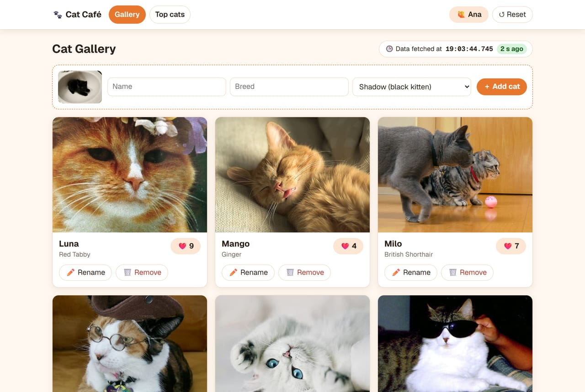
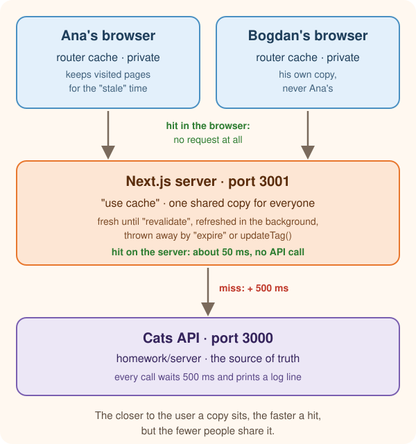
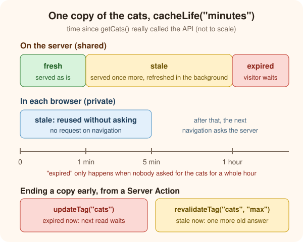
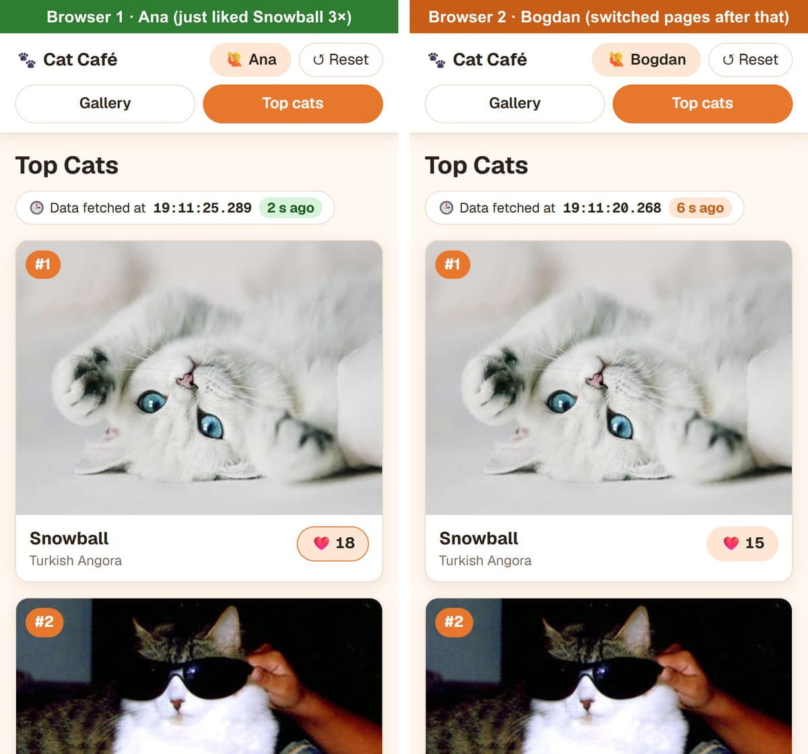

# Next.js Caching


_Professor Mittens will be watching your cache hits today._

In this lesson you take a slow cat app and make it fast with Next.js caching, one step at a time. Then you break it on purpose: two users, stale numbers, lost likes and private data in the wrong place. Every step is something you run and watch, not just read.

You need: Node.js, two terminals, Chrome (or any browser with DevTools), and a second browser or an incognito window for the two-user parts.

<div style="float: right;">0 → 10 min</div>

## What is caching?

Plain version: a cache is a **copy of a result, kept closer than the original**, so the next person who asks doesn't have to wait for the slow work again.


Mango doesn't walk to the kitchen every time she's hungry. She keeps a bowl next to her bed. The bowl is fast, but it only holds what was put in it the last time. If someone puts fresher food in the kitchen, Mango won't know until the bowl is refilled.

That's every cache ever: **fast, but possibly out of date.** The whole lesson is about that trade.

### The words you'll need

| Word                       | Meaning                                                                   | In the cat app                                         |
| -------------------------- | ------------------------------------------------------------------------- | ------------------------------------------------------ |
| **Source of truth**        | the one place where the real data lives                                   | the cats API in `homework/server`                      |
| **Hit / miss**             | hit: a usable copy exists. Miss: no copy, so the slow work runs           | miss = 500 ms wait, hit = almost instant               |
| **Cache key**              | the label of one stored copy. Different inputs → different copies         | `getCats()` with no arguments → one copy for everyone  |
| **Fresh / stale**          | fresh: young enough to use as is. Stale: too old, should be refreshed     | a copy from 10 s ago vs. one from 2 hours ago          |
| **TTL** (time to live)     | how long a copy stays fresh                                               | `cacheLife("minutes")`                                 |
| **Invalidation**           | throwing a copy away on purpose, because the data changed                 | someone likes a cat → the old list must go             |
| **Stale-while-revalidate** | serve the old copy now, fetch a new one in the background for next time  | you see the old list once, the next visitor sees the new one |

### Two kinds of cache

- A **private** cache belongs to one user, like your browser's memory. It never mixes users.
- A **shared** cache sits on the server and serves **everyone** from the same copy. One slow call can make a thousand visitors fast, but whatever goes in is seen by everyone.

> ❓ Which of these could safely live in a **shared** cache: the list of cats, the number of likes per cat, the name of the person using this browser, the cat pictures?
>
> <details>
> <summary>Show answer</summary>
>
> _(The cat list, the like counts and the pictures are the same for every visitor, so they can be shared. Like counts change often, so their copy will get old quickly, but they're still the same for everyone. **The visitor's name is private**: it's different for every browser, and putting it in a shared cache would show Ana's name to Bogdan. Keep that rule in mind for the last trap of the lesson.)_
>
> </details>

> 💡 Every cache answers two questions: **who shares this copy** (one user or everyone?) and **when does it stop being trusted** (after some time, or when something changes?). If you can't answer both for a piece of data, don't cache it yet.

<div style="float: right;">10 → 20 min</div>

## Meet the Cat Café

Plain version: a two-page cat app that talks to a deliberately slow API. Right now it caches nothing, so you'll feel every single request.

### Step 1: get the code

If you don't have the homework repository yet:

```bash
npx degit svs-ong/web-svs-ong/homework homework
cd homework
```

If you already have it, `git pull` to get the `next-caching` folder and the new cats API in `server`.

### Step 2: start the cats API (terminal 1)

```bash
cd server
npm install
npm start
```

It runs on [http://localhost:3000](http://localhost:3000). **Keep this terminal visible.** Every request that reaches the API prints a line:

```plaintext
[18:51:48.667] GET /cats → 200 (506 ms)
```

Every `/cats` call waits 500 ms on purpose, like a slow database. That log is your truth detector for the whole lesson: **a line means the data really came from the source; no line means somebody answered from a cache.**

### Step 3: start the app (terminal 2)

```bash
cd next-caching
npm install
npm run prod
```

`npm run prod` builds the app and starts it on [http://localhost:3001](http://localhost:3001).

> 💡 Why `prod` and not `dev`? Caching only behaves like the real thing in a production build. In `npm run dev`, links are never prefetched, and every time you save a file the cache is thrown away. **After every code change in this lesson: `Ctrl + C`, then `npm run prod` again.**



Two pages, built from the same `CatBoard` component:

- **Gallery** (`/cats`): every cat A–Z. Like, add, rename or remove cats.
- **Top cats** (`/leaderboard`): the same cats sorted by likes, so every like can change the order.

Above each list, **🕒 Data fetched at …** shows the moment `getCats()` really talked to the API, and how old that data is now. Click **🙋 Guest** in the header to give your browser a name. **↺ Reset** puts the original cats back.

The two files you'll edit in this lesson:

```ts
// src/lib/cats.ts — reads the cats
export const getCats = async (): Promise<CatsSnapshot> => {
  // no-store: fetch keeps no copy of its own, so in this lab only "use cache" decides what is cached
  const response = await fetch(`${API_URL}/cats`, { cache: "no-store" });
  if (!response.ok) {
    throw new Error(`GET /cats failed with ${response.status}`);
  }
  const cats: Cat[] = await response.json();

  return { cats, fetchedAt: new Date().toISOString() };
};
```

```ts
// src/lib/actions.ts — Server Actions that change the cats (excerpt)
"use server";

import { refresh } from "next/cache";

// Runs after every write, so the page shows the new data
const afterChange = () => {
  refresh();
};

export const likeCat = async (cat: Pick<Cat, "id" | "likes">): Promise<ActionResult> => {
  const result = await sendToApi(`/cats/${cat.id}`, "PATCH", { likes: cat.likes + 1 });
  afterChange();
  return result;
};
```

`refresh()` asks Next.js to re-render the current page after a change, so the new numbers show up.

### Step 4: feel the pain

Mobile first: open DevTools, turn on the device toolbar and pick a **375 px** wide phone.


> 🔧 **Exercise:** switch between **Gallery** and **Top cats** five times. Watch two things: the page (what do you see while you wait?) and terminal 1 (count the new lines). Then like a cat on **Top cats** and watch the terminal again.
>
> <details>
> <summary>Show answer</summary>
>
> - Every switch shows the grey loading skeleton for about half a second. That's `loading.tsx`, shown while the server waits for the API.
> - Five switches → **five** `GET /cats` lines. In our run each switch took about 550 ms: 500 ms of API, plus a little for Next.js.
> - A like prints two lines: `PATCH /cats/6` (the write), then `GET /cats` (the `refresh()` re-render reading the list again). So **one click = 1 s of waiting**.
> - The "Data fetched at" time is always a second or two old: every page view is a brand-new API call.
>
> </details>

> ❓ The list of cats is the same for everybody, and it changes maybe a few times a minute. How many times per minute does the API get asked for it if 100 students are clicking around?

<div style="float: right;">20 → 35 min</div>

## The server cache: `"use cache"`

Plain version: put `"use cache"` at the top of a function, and Next.js keeps its return value. The next call with the same arguments gets the stored copy, without running the function.



### Step 5: cache `getCats`

```ts
// src/lib/cats.ts
import { cacheLife } from "next/cache";
import { API_URL } from "@/lib/api";
import type { Cat, CatsSnapshot } from "@/model/cat";

// Reads every cat from the API. The API waits 500 ms before answering.
export const getCats = async (): Promise<CatsSnapshot> => {
  "use cache";
  cacheLife("minutes");

  // no-store: fetch keeps no copy of its own, so in this lab only "use cache" decides what is cached
  const response = await fetch(`${API_URL}/cats`, { cache: "no-store" });
  // ...unchanged
};
```

Two new lines:

- `"use cache"` must be the **first line** of the function body, like `"use server"` is the first line of a file.
- `cacheLife("minutes")` says how long the copy is trusted. `"minutes"` is a preset: fresh for **1 minute**, thrown away after **1 hour** without visits, and kept by the browser for **5 minutes**.

Rebuild with `npm run prod` (`Ctrl + C` first). **Watch terminal 1 during the build.**

> 🔧 **Exercise:** repeat Step 4: switch pages five times and count the log lines. Look at the "Data fetched at" time, and at the build output in terminal 2.
>
> <details>
> <summary>Show answer</summary>
>
> - During `npm run build` the API logs **one** `GET /cats`. Next.js already called `getCats()` while building, and both pages used that one result.
> - The build table now has new columns: `/cats  1m  1h` and `/leaderboard  1m  1h`. That's `revalidate` and `expire` from `cacheLife("minutes")`.
> - Switching pages takes about **50 ms instead of 550 ms**. No skeleton, and **zero** new log lines.
> - "Data fetched at" stopped moving. It shows when the copy was made, not when you opened the page.
>
> </details>

### Step 6: a second user

Open [http://localhost:3001/leaderboard](http://localhost:3001/leaderboard) in a second browser or an incognito window, and name that user (for example, Bogdan).

> ❓ Bogdan has never opened the app before. Does his first visit call the API?
>
> <details>
> <summary>Show answer</summary>
>
> _(No new `GET /cats` line, and his "Data fetched at" shows the same time as yours. The copy lives on the **server** and is **shared**. Bogdan gets the copy your visit (or the build) already paid for. That's the superpower of a server cache: one slow call, any number of fast visitors.)_
>
> </details>

### What happens after a minute?

Wait until "Data fetched at" says more than 60 s ago, then reload the page twice, watching terminal 1.



The first reload still shows the old time, **and** a `GET /cats` line appears. The second reload shows a new time. That's **stale-while-revalidate**: after the `revalidate` time (1 minute here), the next visitor still gets the old copy instantly, and Next.js fetches a fresh one in the background for whoever comes next. Nobody waits 500 ms.

> 💡 Next.js keeps the cached copy **in the memory of the server process**. Stop `npm run prod` and start it again, or deploy a new version, and every copy is gone: the first visitor pays the full price again. In production with several servers, each server has its own copy.

<div style="float: right;">35 → 50 min</div>

## Trap 1: "my like vanished"


> 🔧 **Exercise:** on **Top cats**, like a cat. Look at the number, then at terminal 1. Then press **↺ Reset**.
>
> <details>
> <summary>Show answer</summary>
>
> - The like button spins, then shows **the same number as before**.
> - The terminal shows `PATCH /cats/6 → 200`. The like **did** reach the API. But there's no `GET /cats` after it anymore.
> - Reset seems broken too: the API resets, the page doesn't change.
>
> </details>

> ❓ The API has the new number. `refresh()` re-rendered the page. So why is the old number still there?
>
> <details>
> <summary>Show answer</summary>
>
> _(`refresh()` re-rendered the page, the page called `getCats()`, and `getCats()` is cached, so it returned the copy from before the like. Nothing told the cache that the cats changed. A cache never knows about changes on its own: **you** have to tell it. That's **invalidation**.)_
>
> </details>

### Step 7: tag the copy, invalidate it after a write

Give the copy a name with `cacheTag`:

```ts
// src/lib/cats.ts
import { cacheLife, cacheTag } from "next/cache";

export const getCats = async (): Promise<CatsSnapshot> => {
  "use cache";
  cacheLife("minutes");
  cacheTag("cats");
  // ...unchanged
};
```

Then, after every write, throw away everything tagged `"cats"`. Replace `refresh()` in `afterChange`:

```ts
// src/lib/actions.ts
import { updateTag } from "next/cache";

// Runs after every write, so the page shows the new data
const afterChange = () => {
  updateTag("cats");
};
```

Rebuild, then like a cat again.

> 🔧 **Exercise:** like a cat and press Reset. What do you see now, and what does terminal 1 print?
>
> <details>
> <summary>Show answer</summary>
>
> _(The new number appears right away. The terminal shows `PATCH /cats/6`, then `GET /cats`. `updateTag("cats")` expired the copy immediately, so the re-render had to fetch fresh data. You see your own change at once. The docs call that "read-your-own-writes". Reset works again too, because it goes through the same `afterChange`.)_
>
> </details>

`updateTag` doesn't need `refresh()` anymore: calling it from a Server Action already makes Next.js re-render the page you're on with fresh data.

### Step 8: the other invalidation, `revalidateTag`

Try the second option. In `afterChange`, replace `updateTag("cats")` with:

```ts
// src/lib/actions.ts
import { revalidateTag } from "next/cache";

const afterChange = () => {
  revalidateTag("cats", "max");
};
```

Rebuild, like a cat, then reload the page twice.

> ❓ What happens to the number after the like, after the first reload, and after the second reload?
>
> <details>
> <summary>Show answer</summary>
>
> _(After the like: the old number, and no `GET`. After the first reload: still the old number, but a `GET /cats` appears in the terminal. After the second reload: the new number. `revalidateTag(tag, "max")` only marks the copy as **stale**: the next reader still gets the old copy instantly, and the refresh happens in the background. Stale-while-revalidate, started on demand.)_
>
> </details>

| Function                      | After it runs                                                | Use it when                                                              |
| ----------------------------- | ------------------------------------------------------------ | ------------------------------------------------------------------------ |
| `updateTag("cats")`           | the copy is **expired**: the next read waits for fresh data | the person who made the change must see it **now** (likes, forms, edits) |
| `revalidateTag("cats", "max")`| the copy is **stale**: one more old answer, fresh in the background | a short delay is fine, speed matters more (a blog post, a product list)   |

> 💡 `updateTag` only works inside Server Actions. `revalidateTag` also works in Route Handlers, for example a webhook that another system calls when its data changes.

**Switch back to `updateTag("cats")`** and rebuild before the next chapter.

<div style="float: right;">50 → 65 min</div>

## Two users at once


Plain version: `updateTag` throws away the **server's** copy. But every user who already loaded a page also has a copy in **their own browser**, and nobody told those copies anything.

Set up two browsers side by side: **Ana** (normal window) and **Bogdan** (incognito or another browser), both on **Top cats**. Press ↺ Reset once.

### Trap 2: stale screens

> 🔧 **Exercise:** as Ana, like **Snowball** three times. Then, as Bogdan, click **Gallery** and back to **Top cats**. What does Bogdan see, and what does terminal 1 print during his clicks?
>
> <details>
> <summary>Show answer</summary>
>
> 
>
> _(Ana sees the new number at once: her Server Action expired the server copy and re-rendered **her** page. Bogdan still sees the old number, and his clicks print **nothing** in the terminal. His browser kept the pages it already had, and reused them without asking the server. More about that browser cache in the next chapter. If Bogdan **reloads** the page (F5), he gets the fresh number, because the server copy is up to date.)_
>
> </details>

### Trap 3: lost likes

Now the dangerous part. Bogdan's screen shows an old number, and the like button sends **the number on the screen + 1**:

```ts
const result = await sendToApi(`/cats/${cat.id}`, "PATCH", { likes: cat.likes + 1 });
```

> 🔧 **Exercise:** keep Bogdan on his old screen. Ana likes Snowball three more times. Then Bogdan likes Snowball once. Reload both pages. How many likes does Snowball have?
>
> <details>
> <summary>Show answer</summary>
>
> _(Fewer than you'd expect. Ana's likes are **gone**. Bogdan's browser thought Snowball had 18 likes, so it sent `likes: 19`, overwriting Ana's 21 with 19. Nobody saw an error, and the API did exactly what it was told. In our run, Mango went from 9 likes down to 6 this way.)_
>
> </details>

> ❓ Who is "right": Ana's screen, Bogdan's screen, or the API?

The API is the source of truth. The bug is that the **write was computed from a cached read**. Fix it by letting the server do the math. The API already has an endpoint that adds one like to whatever number it has: `POST /cats/:id/like`.

```ts
// src/lib/actions.ts
export const likeCat = async (cat: Pick<Cat, "id" | "likes">): Promise<ActionResult> => {
  const result = await sendToApi(`/cats/${cat.id}/like`, "POST");
  afterChange();
  return result;
};
```

> 🔧 **Exercise:** rebuild and repeat the exercise above. Does every like count now?

> 💡 Never compute a write from a cached read. Send **what happened** ("one more like"), not **what you think the result is** ("19 likes"). The more you cache, the older your reads can be, and the more often this bug bites.

> ❓ Ana removes **Milo**. Bogdan, still on his old screen, clicks Milo's like button. What do you expect? Try it.
>
> <details>
> <summary>Show answer</summary>
>
> _(The API answers `404 Cat not found` (check terminal 1). The action's `updateTag` then re-renders Bogdan's page with fresh data, so Milo just disappears from under his finger. A stale screen can always offer actions on things that no longer exist, so every write must be ready for "not found".)_
>
> </details>

<div style="float: right;">65 → 80 min</div>

## Navigating between pages: the browser cache


Plain version: when you visit a page, the browser keeps what the server sent. Go back to that page within its `stale` time, and the browser shows it **without asking the server at all**.

That's the Next.js **client router cache**. It's private: one per browser tab, gone when you reload.

### See it in DevTools

Open DevTools → **Network**, and type `_rsc` in the filter box. Each page change that asks the server shows up as a request with `?_rsc=` in its URL.

> 🔧 **Exercise:** reload the page, then switch Gallery ↔ Top cats a few times. Watch the Network panel and terminal 1.
>
> <details>
> <summary>Show answer</summary>
>
> - Right after the reload, a few `_rsc` requests appear on their own, before you click anything. That's **prefetching**: in a production build, Next.js loads the pages behind the visible `<Link>`s in the background.
> - After that, your switches add **no** new `_rsc` requests: the browser answers from its own cache. The API terminal stays quiet too.
>
> </details>

How long does the browser trust its copy? The `stale` value of `cacheLife`: **5 minutes** for every preset except `"seconds"`. That's why Bogdan kept seeing old likes in the last chapter.

### Step 9: choose your own stale time

Replace the preset with your own numbers (in seconds):

```ts
// src/lib/cats.ts
cacheLife({ stale: 30, revalidate: 60, expire: 3600 });
```

| Property     | Meaning                                                                                     |
| ------------ | ------------------------------------------------------------------------------------------- |
| `stale`      | how long the **browser** reuses the page without asking. Next.js enforces at least 30 s |
| `revalidate` | how long the **server** copy is fresh. After that: stale-while-revalidate               |
| `expire`     | with no visits for this long, the server copy is thrown away and the next visitor waits  |

> 🔧 **Exercise:** rebuild. Put Ana and Bogdan side by side again. Ana likes a cat. Bogdan switches pages after 10 s, after 25 s, and after 35 s. When does Bogdan see the new number?
>
> <details>
> <summary>Show answer</summary>
>
> _(At 10 s and 25 s: the old number, and no request at all. At 35 s: the new number. The browser's 30 s were over, so it asked the server, and the server copy was already fresh thanks to Ana's `updateTag`. In our run: 0 requests at +10 s and +25 s, fresh data at +35 s.)_
>
> </details>

> ❓ The browser cache made Bogdan's screen wrong for up to 5 minutes. When is that perfectly fine, and when is it not?
>
> <details>
> <summary>Show answer</summary>
>
> _(Fine: a list that changes rarely, where being a few minutes behind hurts nobody, like course chapters, a blog or a menu. Not fine: anything people act on together in real time, like stock levels, a seat booking or an auction. There, use a short `stale`, or don't cache that part. And remember: the person who **made** a change always sees it immediately, because `updateTag` in their own Server Action also clears their browser cache.)_
>
> </details>

> 💡 The pages switch instantly even on the very first click because of prefetching: Next.js already loaded them in the background. Prefetching only runs in production builds, one more reason this lesson uses `npm run prod`.

<div style="float: right;">80 → 92 min</div>

## Trap 4: private data in a shared cache


Plain version: the server cache is shared by everyone. Anything personal that ends up inside it is shown to the wrong people.

New feature request: the board should greet the visitor, "Hi Ana, here are your cats". The visitor's name is in the `visitor` cookie, so you try the obvious thing:

```ts
// src/lib/cats.ts — ❌ don't keep this
import { cacheLife, cacheTag } from "next/cache";
import { cookies } from "next/headers";

export const getCats = async (): Promise<CatsSnapshot & { greeting: string }> => {
  "use cache";
  cacheLife({ stale: 30, revalidate: 60, expire: 3600 });
  cacheTag("cats");

  const visitor = (await cookies()).get("visitor")?.value ?? "Guest";

  // ...fetch the cats, unchanged

  return { cats, fetchedAt: new Date().toISOString(), greeting: `Hi ${visitor}, here are your cats` };
};
```

> 🔧 **Exercise:** make this change and run `npm run build`. Read the error carefully.
>
> <details>
> <summary>Show answer</summary>
>
> ```plaintext
> Error: Route "/cats": `cookies()` can't be read inside `"use cache"`. Read it outside the cached
> function and pass what you need as an argument.
> ```
>
> _(Next.js refuses to build. Imagine it didn't: Ana visits first, her greeting gets cached, and every visitor for the next minute reads "Hi Ana". With a shopping cart or a grade book instead of a greeting, that's a real data leak.)_
>
> </details>

> ❓ The error says "pass what you need as an argument". What changes if `getCats(visitor)` takes the name as an argument?
>
> <details>
> <summary>Show answer</summary>
>
> _(Arguments are part of the **cache key**. `getCats("Ana")` and `getCats("Bogdan")` become two separate copies, so nobody sees someone else's greeting. It's correct, but look at the cost: in our test, every new visitor caused a fresh `GET /cats`, because each person now has their own copy of the **same** cat list. With 1000 users, that's 1000 copies and 1000 API calls. And because the board now reads a cookie, every page view renders on the server again: the skeleton is back.)_
>
> </details>

The better fix is already in your app: the header's **🙋 name button** reads the cookie in its own small component (`src/components/Visitor.tsx`), **outside** any cache. The shared cat list stays shared, and only the tiny personal part is per user. **Undo the greeting change** before you go on.

| Data                         | Same for everyone? | Where to keep it                                                                                     |
| ---------------------------- | ------------------ | ---------------------------------------------------------------------------------------------------- |
| cat list, likes              | yes                | `"use cache"` + `cacheTag`, invalidated by the Server Actions that change it                          |
| visitor name, cart, progress | no                 | read outside the shared cache. If it must be cached: as an argument, or with `"use cache: private"` |

> 💡 `"use cache: private"` is a third directive for exactly this case. It may read `cookies()` directly, and its result is kept **only in that user's browser**, never in the shared server cache.

<div style="float: right;">92 → 100 min</div>

## Wrap-up


What you built, and what each piece costs:

| Tool                              | Where the copy lives  | Shared?        | You pay with                                               |
| --------------------------------- | --------------------- | -------------- | ---------------------------------------------------------- |
| `"use cache"` + `cacheLife`       | Next.js server memory | yes, everyone  | data up to `revalidate` old, unless you invalidate          |
| `cacheTag` + `updateTag`          | (removes copies)      |                | you must call it on **every** write path                   |
| `revalidateTag(tag, "max")`       | (marks copies stale)  |                | one more old answer after a change                         |
| client router cache (`stale`)     | each browser          | no, per user   | other users' changes show up only after `stale`             |
| prefetching (`<Link>`)            | each browser          | no, per user   | extra requests in the background, production builds only   |

### The `cacheLife` presets

| Preset    | `stale` (browser) | `revalidate` (server) | `expire`   |
| --------- | ----------------- | --------------------- | ---------- |
| `default` | 5 min             | 15 min                | never      |
| `seconds` | 30 s              | 1 s                   | 1 min      |
| `minutes` | 5 min             | 1 min                 | 1 hour     |
| `hours`   | 5 min             | 1 hour                | 1 day      |
| `days`    | 5 min             | 1 day                 | 1 week     |
| `weeks`   | 5 min             | 1 week                | 30 days    |
| `max`     | 5 min             | 30 days               | 1 year     |

### The trap checklist

- [ ] Every Server Action that changes data calls `updateTag` (or `revalidateTag`) for that data.
- [ ] Changes made **outside** your app are invisible to the cache until `revalidate` runs out. Try it: `curl -X POST http://localhost:3000/cats/reset` (in PowerShell: `curl.exe -X POST http://localhost:3000/cats/reset`) and watch the app keep showing the old cats.
- [ ] Writes send **what happened**, never a number computed from a cached read.
- [ ] Nothing personal goes into a shared cache: cookies, user ids, carts, grades.
- [ ] Test caching with a production build. `npm run dev` doesn't prefetch, and it drops the cache on every save.
- [ ] A restart or a new deploy starts with an empty cache. With several servers, each server has its own copy.
- [ ] Data that changes every second (a chat, live scores) is a bad candidate. Cache what's read often and changes rarely.

### What about TanStack Query?

[TanStack Query](https://tanstack.com/query/latest) is a popular cache for data that the **browser** fetches itself, in Client Components. It keys data like `["cats"]`, refetches when you come back to the tab, and retries failed requests. In this app every read happens on the server, so `"use cache"` and the router cache cover it. Reach for TanStack Query when a page loads lots of data in the browser, for example a live dashboard or infinite scrolling, not as a replacement for server caching.

> ❓ Final check. For each one, pick shared server cache, browser only, or no cache: (1) the list of course chapters, (2) a student's quiz score, (3) a live chat, (4) today's menu in the school canteen.
>
> <details>
> <summary>Show answer</summary>
>
> _(1) Shared server cache, with `cacheTag` and `updateTag` when a teacher edits a chapter: the same for everyone, and it changes rarely. (2) Not in a shared cache: it's personal. Read it per request, or cache it per user (argument or `"use cache: private"`). (3) No cache: it changes every second, and stale messages are worse than slow ones. (4) Shared server cache with a long `cacheLife`, like `"hours"`: everyone sees the same menu, and it changes once a day.)_
>
> </details>
